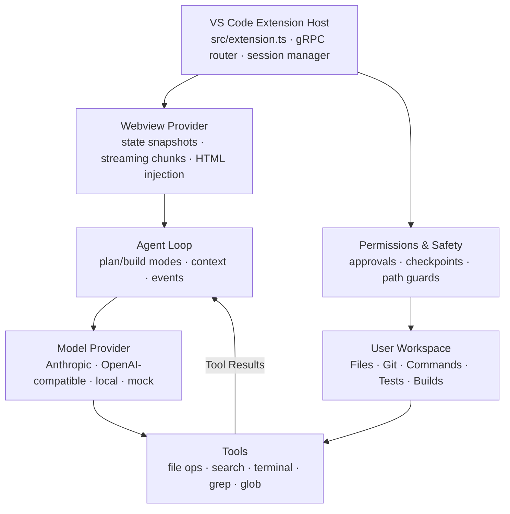
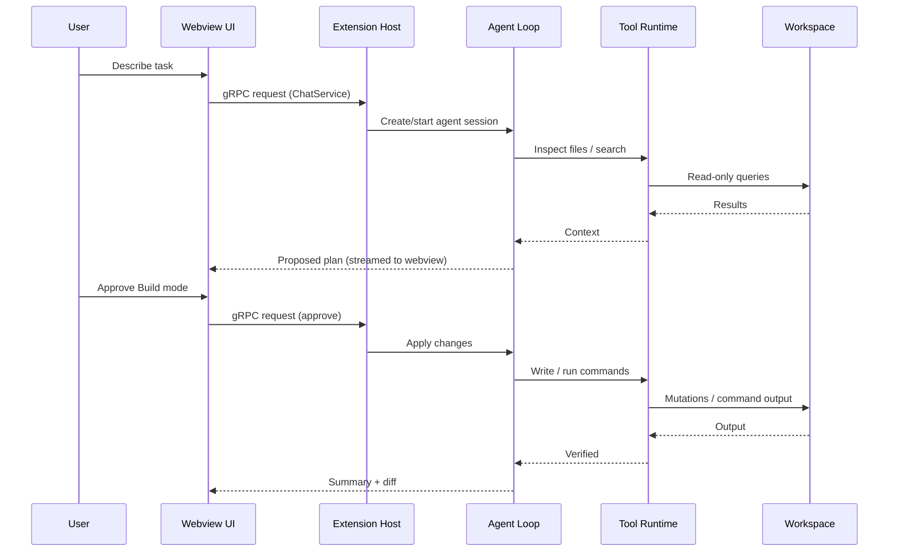

<div align="center">

# ⚡ NEXIPI

**AI coding agent for VS Code — built into your editor.**

Plan, build, inspect, and verify code from inside VS Code with a webview chat interface.

[](./LICENSE)
[](https://nodejs.org/)
[](https://www.typescriptlang.org/)
[](https://code.visualstudio.com/)
[](./CONTRIBUTING.md)

</div>

---

## ✨ What is NEXIPI?

**NEXIPI** is an AI coding agent that works directly inside VS Code. Describe what you want in natural language, and NEXIPI can inspect your project, propose a plan, make changes, run commands, execute tests, and verify the result — all from a webview chat panel.

It is designed for developers who want an agent that is:

- **Editor-native** — runs as a VS Code extension webview, no terminal switching required.
- **Workspace-aware** — understands files, Git state, commands, and project context.
- **Safe by default** — Plan mode prevents accidental changes.
- **Transparent** — every tool call, file edit, command, and result is visible in the chat panel.
- **Model-flexible** — works with Anthropic, OpenAI-compatible APIs, and local models.
- **Web-aware** — can search the web for current information.

---

## 🚀 Features

### 🧠 Autonomous coding workflow

Give NEXIPI a high-level task:

```
Add dark mode support to the settings page
```

NEXIPI can:

1. Inspect relevant files.
2. Understand the existing implementation.
3. Propose a structured plan.
4. Apply approved changes.
5. Run tests or builds.
6. Report what changed and why.

### 🗂️ Workspace awareness

NEXIPI can work with your project through tools such as:

- Read and inspect files.
- Search code with grep-style queries.
- Navigate the workspace with glob patterns.
- Read Git status and repository context.
- Run shell commands, builds, linters, and tests.
- Create, edit, and update files with approval.
- Search the web for up-to-date information.

### 🔁 Plan and Build modes

NEXIPI separates thinking from execution.

| Mode | Purpose | File changes |
|---|---|---|
| **Plan** | Explore, analyze, and propose a solution | ❌ No writes |
| **Build** | Implement the approved plan | ✅ Writes allowed |

In **Plan mode**, NEXIPI can read and search your workspace but will not modify files.  
In **Build mode**, it can apply changes, run commands, and verify results.

### 💬 Webview chat interface

NEXIPI renders a React-based chat interface inside a VS Code webview. Agent responses, tool calls, and status updates stream live via gRPC between the extension host and the webview UI.

### 🛡️ Safety and approvals

NEXIPI is built to be cautious with your workspace.

Approval controls can cover:

- File writes and deletions.
- Shell command execution.
- Git operations.
- Network requests.
- Potentially destructive actions.

You can configure approval behavior as:

| Mode | Behavior |
|---|---|
| `ask` | Ask before risky actions |
| `auto` | Automatically approve selected safe actions |
| `never` | Read-only mode |

### 💾 Sessions and checkpoints

NEXIPI can preserve session history and create checkpoints before important changes.

This helps you:

- Review what the agent did.
- Resume a previous session.
- Inspect tool activity.
- Roll back to a prior workspace state.

### 🔌 Pluggable model providers

NEXIPI supports a provider abstraction so you can choose the model that fits your workflow:

- Anthropic
- OpenAI-compatible APIs
- Local models
- Mock provider for development and testing

---

## 📦 Installation

### Prerequisites

- Node.js 18 or later
- npm
- VS Code 1.85 or later
- An API key for at least one supported provider

### Install from source

```bash
git clone https://github.com/toolifyai4-cell/toolify_v1.git
cd toolify_v1
npm install
npm run build
```

Then open VS Code with the extension loaded:

```bash
npm run launch
```

---

## ⚙️ Configuration

Create a `toolify.config.json` file in your workspace root:

```json
{
  "providers": {
    "anthropic": {
      "apiKey": "${env:ANTHROPIC_API_KEY}",
      "model": "claude-3-5-sonnet-20241022"
    },
    "openai": {
      "apiKey": "${env:OPENAI_API_KEY}",
      "baseUrl": "https://api.openai.com/v1",
      "model": "gpt-4o"
    }
  },
  "defaultProvider": "anthropic",
  "approvalMode": "ask",
  "maxTokens": 8192,
  "temperature": 0.1
}
```

Use environment variables for API keys. Avoid committing secrets to your repository.

---

## 🧭 Usage

### VS Code extension

1. Open the Command Palette (`Ctrl+Shift+P` / `Cmd+Shift+P`).
2. Run `Toolify: Open Chat`.
3. The TOOLIFY webview panel opens.
4. Choose a model.
5. Describe your task.
6. Review the plan.
7. Approve Build mode when ready.

### Example prompts

```
Add a dark mode toggle to the settings page
Write unit tests for the auth service
Refactor the user repository to use the new database client
Find and fix the memory leak in the WebSocket handler
Create a REST endpoint for exporting reports
Explain how authentication works in this project
```

---

## 🏗️ Architecture



### Core modules

| Module | Responsibility |
|---|---|
| `src/extension.ts` | Extension activation, webview view registration, gRPC service wiring |
| `src/extension/agent-session-manager.ts` | Long-running agent session lifecycle per session ID |
| `src/extension/auth-integration.ts` | VS Code native auth + session store bridge |
| `src/core/webview/WebviewProvider.ts` | Abstract gRPC routing + webview HTML injection |
| `src/hosts/vscode/VscodeWebviewProvider.ts` | Concrete VS Code webview view provider |
| `src/agent/` | Agent loop, context management, events, loop detection |
| `src/tools/` | File operations, search, terminal, grep, glob, task tools |
| `src/models/` | Model registry, pricing, quota, verification |
| `src/providers/` | Streaming providers and provider abstractions |
| `src/persistence/` | Sessions, checkpoints, and storage |
| `src/safety/` | Approval service for risky operations |
| `src/core/controller/` | Chat, config, auth, terminal controllers |
| `webview-ui/` | React + Vite chat interface (ChatView, Settings, History, Account) |
| `src/verify/` | Verification gate for builds and tests |

---

## 🔄 Agent Workflow



---

## 🧪 Development

### Build the extension and webview UI

```bash
npm run build
```

This bundles `src/extension.ts` into `dist/extension.js` and builds the React webview UI into `dist/webview-ui/`.

### Watch the webview UI during development

```bash
npm run dev:webview
```

Runs Vite dev server at `localhost:5173` for fast webview iteration.

### Launch VS Code with the extension

```bash
npm run launch
```

Opens VS Code with `--extensionDevelopmentPath=.` so you can test the extension live. Press `F5` inside VS Code for the same effect.

### Run tests

```bash
npm test
```

### Typecheck

```bash
npm run typecheck
```

### Typecheck webview UI

```bash
npm run typecheck:webview
```

---

## 🤝 Contributing

Contributions are welcome — and contributors will be <span style="color:#22c55e;font-weight:bold">paid according to their contributions</span> once NEXIPI grows into a well-known company and its user base scales.

> We're more than a codebase — we're a family building NEXIPI together. Every contribution, big or small, matters, and we're here to support each other through the journey. Whether you're fixing a typo, designing a feature, or just asking questions, you belong here. Let's grow this into something great, together. 💛

1. Fork the repository.
2. Create a feature branch.
3. Make your changes.
4. Add or update tests.
5. Run:

```bash
npm run typecheck
npm test
```

6. Open a pull request.

<details>
<summary><b>📋 Contribution checklist</b></summary>

- [ ] Code compiles (`npm run build`)
- [ ] Typecheck passes (`npm run typecheck`)
- [ ] Tests pass (`npm test`)
- [ ] New behavior is documented
- [ ] No secrets committed
- [ ] License headers preserved

</details>

---

## 📄 License

Licensed under the [Apache License 2.0](./LICENSE).

Copyright 2026 **NAVEEN RAJ A**.

<details>
<summary><b>📜 License summary</b></summary>

Apache License 2.0 is a permissive license that allows you to:

- ✅ Use the software for any purpose.
- ✅ Modify and distribute it.
- ✅ Use patents granted by contributors.
- ✅ Include it in proprietary software.

Conditions you must meet:

- 📄 Include a copy of the license.
- 📝 State any significant changes.
- 🏷️ Retain copyright, patent, trademark, and attribution notices.

Limitations:

- ❌ No trademark rights are granted.
- ❌ No warranty is provided.
- ❌ No liability is assumed.

Full text: [`LICENSE`](./LICENSE).

</details>

---

<div align="center">

Made with ⚡ by NAVEEN RAJ A · Licensed under Apache 2.0

</div>
